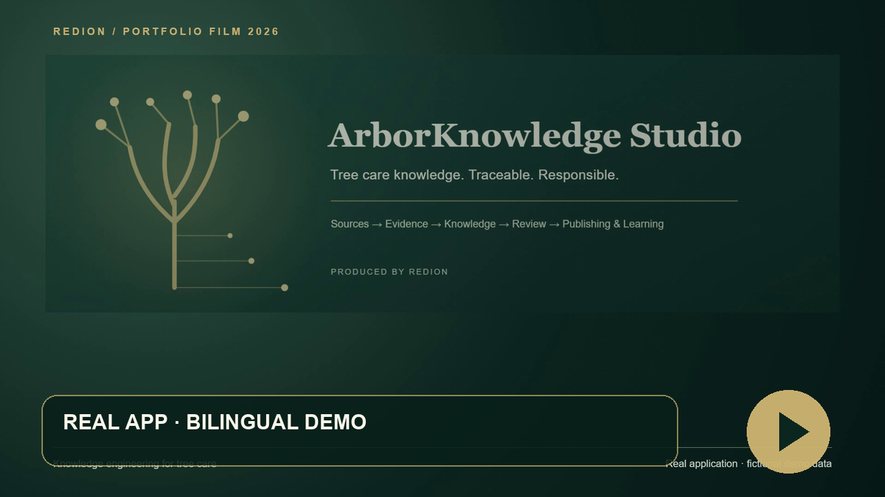

# ArborKnowledge Studio

**A local knowledge and editorial platform for professional tree care.** ArborKnowledge Studio connects sources, traceable knowledge units, human review and professional content creation. The same controlled knowledge base can support chapters, practical materials and learning.

**[Deutsch / main README](README.md)** · **As of 27 October 2026** · **Produced by RediON**

## Watch in English or German

**[Interactive player: Deutsch | English](https://iamredi.github.io/arbor-knowledge-studio-showcase/?lang=en)** · [DE/EN transcript](media/transcript.md)

| Version | Film | Subtitles |
|---|---|---|
| Master EN · 1920 × 1080 | [MP4](media/arbor-knowledge-studio-master-en.mp4) | [EN-SRT](media/arbor-knowledge-studio-master-en-captions-en.srt) · [DE-SRT](media/arbor-knowledge-studio-master-en-captions-de.srt) |
| Master DE · 1920 × 1080 | [MP4](media/arbor-knowledge-studio-master-de.mp4) | [DE-SRT](media/arbor-knowledge-studio-master-de-captions-de.srt) · [EN-SRT](media/arbor-knowledge-studio-master-de-captions-en.srt) |
| Social EN · 1080 × 1920 | [MP4](media/arbor-knowledge-studio-social-en.mp4) | [EN-SRT](media/arbor-knowledge-studio-social-en-captions-en.srt) · [DE-SRT](media/arbor-knowledge-studio-social-en-captions-de.srt) |
| Social DE · 1080 × 1920 | [MP4](media/arbor-knowledge-studio-social-de.mp4) | [DE-SRT](media/arbor-knowledge-studio-social-de-captions-de.srt) · [EN-SRT](media/arbor-knowledge-studio-social-de-captions-en.srt) |

The four films show the **running local application** with fictional data. German and English have separate Azure Speech narration, scene timing and selectable DE/EN subtitles in SRT and VTT. Visible UI labels were translated to English in the browser for this public presentation; product behavior, data and private source code were unchanged. The intro and architecture cards are original editorial graphics. The films do not claim a successful live AI response.

| Status | Scope shown or described |
|---|---|
| **Implemented** | Sources, knowledge units, provenance links, chapters, versions, approvals, DOCX export and course views |
| **Verified** | Synthetic end-to-end case, 261 tests, V4 smoke test and desktop/mobile browser checks |
| **In Development** | Adaptive multilingual AI teaching branch in private draft review; live API currently unverified due to `invalid_api_key` |
| **Vision** | Broader professional literature pipeline, more learning formats and isolated domain spaces |

## The problem it addresses

Professional tree care draws on literature, standards, training and documented field experience. During writing and teaching, source locations, usage rights, uncertainty and editorial decisions can become hard to trace. The Studio keeps those links explicit. Its working chain is:

**Source → source location → knowledge unit → human review → professional content → DOCX export or learning**

AI can propose text or review findings. It does not approve evidence or replace the arborist. **Upgrade humans. Not replace them.**

## What is implemented and verified

| Area | Current capability |
|---|---|
| Source library | Metadata, rights labels, managed local attachments and source locations |
| Knowledge | Typed knowledge units and explicit provenance links |
| Retrieval | Local lexical search; optional configured local semantic and hybrid retrieval |
| Editorial | Books, chapters, versions, comments, approval gates and DOCX export |
| Study | Courses, selected materials, coverage, deterministic learning flow and progress |
| AI | Optional bounded drafting and evidence review. The configured credentials were rejected in this session, so live model quality is **not** claimed. |

The private adaptive multilingual AI teaching branch has verification evidence but is **awaiting owner acceptance**. The original interface contains Albanian labels. English UI text in this showcase is a **presentation translation**, not a shipped product localization. This is a local application, with no public SaaS deployment.

## A real application demonstration with fictional data

The screenshots show the running application on Chrome against an isolated synthetic database. Visible UI text was translated to English in the browser before capture. The entirely fictional “Nordpark 07” case contains two self-authored source records, three linked knowledge units, a versioned chapter with a resolved review comment, an approval and DOCX export, plus a course with material and coverage views. The fictional case is not tree care advice.

| Source library | Traceable knowledge |
|---|---|
|  |  |

| Editorial workspace | Mobile view |
|---|---|
|  |  |

## Architecture and safeguards

The local stack uses Python, FastAPI, Jinja2 and SQLite, bound to `127.0.0.1`. Retrieval is advisory. Explicit selection controls what evidence an AI request may use. Generated drafts remain proposals until a person applies them; review output does not alter a chapter or its approval. Rights for reading, external AI processing and publication are distinct.

Source citations support traceability, but do not by themselves prove a scientific claim. The current real knowledge library does not yet include a top-tier normative source. Public media therefore uses only self-authored fictional data.

## Verification and roadmap

The isolated Windows/Python 3.13 worktree passed **261 automated tests** and the full local V4 smoke test, including backup/restore and stop/restart/resume. A synthetic end-to-end flow exercised creation, provenance, editorial approval, DOCX and study; **20 Chrome views** passed desktop/mobile checks without JavaScript errors, 404s or page-level horizontal overflow. Two capped live API calls received `authentication` errors; a subsequent no-generation credential check returned `401 invalid_api_key`. No further generation was attempted. See [verification evidence](EVIDENCE.md).

Longer-term work includes broader literature processing, guided editorial workflows, multilingual learning content, assessments and isolated knowledge spaces for other domains. These are roadmap items unless explicitly listed above as implemented and verified.

## Collaboration

The project is relevant to arboriculture companies, training providers, researchers and product teams working on source quality, professional publishing, local retrieval and controlled AI. The full application source remains in a separate **private repository**; this repository is a public showcase only. Contact [Redion Cekrezi on GitHub](https://github.com/IamRedi) to discuss collaboration.

**Redion Cekrezi — Full-Stack & Applied AI Developer**

**Produced by RediON**

See [media rights and provenance](RIGHTS.md).
