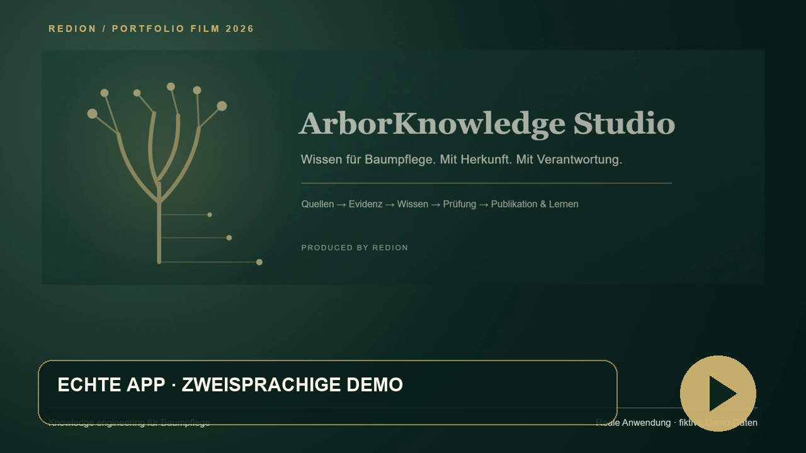
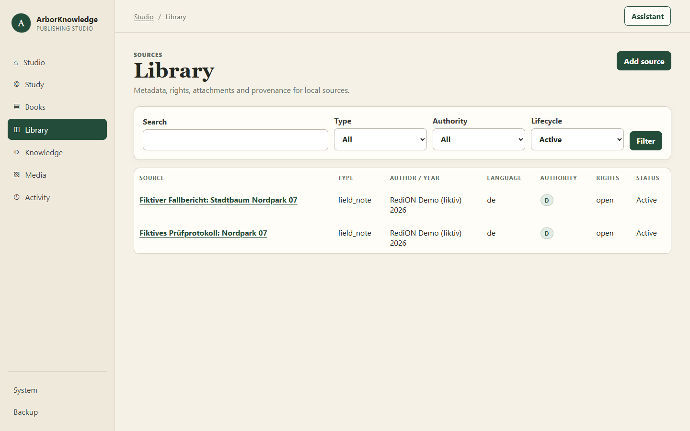
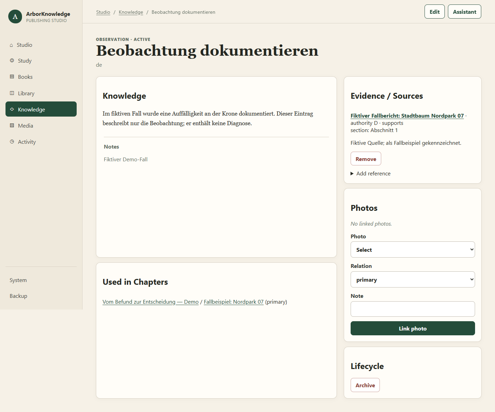
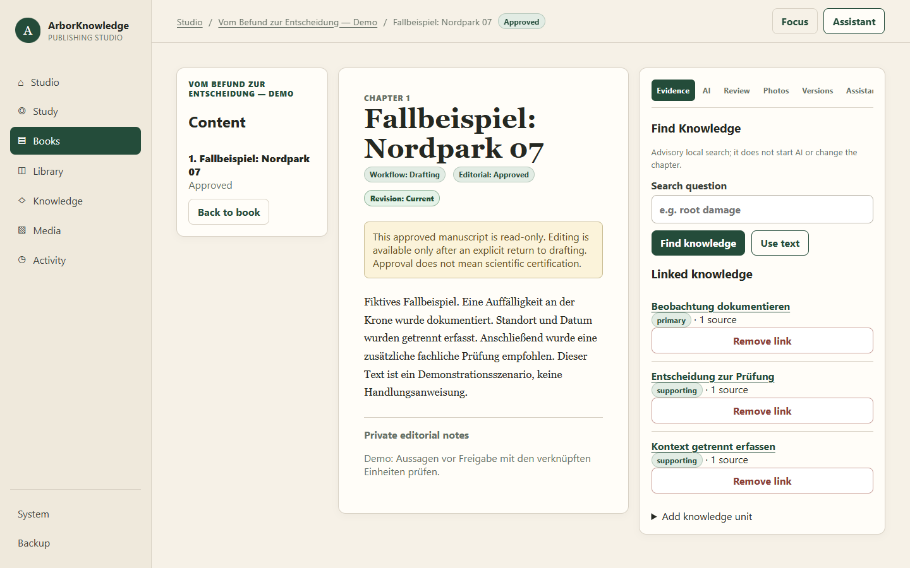
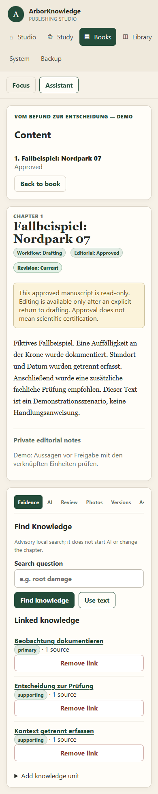
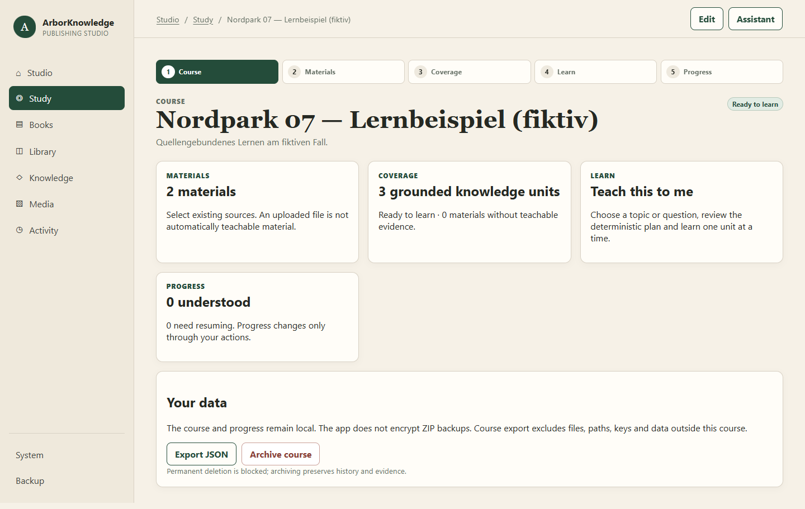
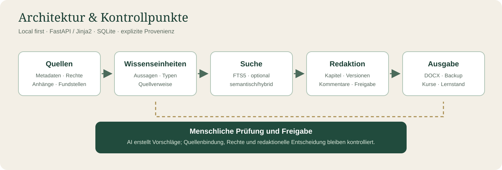

# ArborKnowledge Studio

**Eine lokale Wissens- und Redaktionsplattform für professionelle Baumpflege.** ArborKnowledge Studio verbindet Quellen, belegte Wissenseinheiten und menschliche Prüfung mit der Erstellung von Fachinhalten. Ein überprüfbarer Wissensbestand kann so für Kapitel, Arbeitsmaterial und Lernen genutzt werden.

**[English version](README.en.md)** · **Stand: 27. Oktober 2026** · **Produced by RediON**

## In 90 Sekunden ansehen

**[Demo-Film im Player ansehen (90 s, 1920 × 1080)](https://iamredi.github.io/arbor-knowledge-studio-showcase/)** · [Vertikaler Kurzfilm (35 s)](https://iamredi.github.io/arbor-knowledge-studio-showcase/#social) · [MP4 herunterladen](media/arbor-knowledge-studio-master.mp4) · [Deutsche Untertitel](media/arbor-knowledge-studio-master-de.srt) · [English subtitles](media/arbor-knowledge-studio-master-en.srt) · [Transkript DE/EN](media/transcript.md)

Die Videoaufnahmen zeigen die **laufende lokale Anwendung** mit ausschließlich fiktiven Daten. Sichtbare UI-Beschriftungen wurden für diese öffentliche Präsentation im Browser ins Englische übersetzt; Funktionen, Daten und privater Produktcode blieben unverändert. Die grafischen Intro- und Architekturtafeln sind eigens erstellte Erläuterungen; der Film behauptet keine erfolgreiche Live-AI-Antwort.

| Status | Was im Film zu sehen ist |
|---|---|
| **Implemented** | Quellen, Wissenseinheiten, Quellverweise, Kapitel, Versionen, Freigaben, DOCX-Export und Kursansichten |
| **Verified** | Synthetischer End-to-End-Fall, 261 Tests, V4-Smoke-Test und Desktop/Mobile-Browserprüfung |
| **In Development** | Adaptiver mehrsprachiger AI-Lehrzweig im privaten Draft-Review; Live-API aktuell wegen `invalid_api_key` nicht verifiziert |
| **Vision** | Breitere Fachliteratur-Pipeline, weitere Lernformate und isolierte Fachräume |

## Warum dieses Projekt?

In der Baumpflege stammen Informationen aus Fachliteratur, Richtlinien, Schulung und dokumentierter Praxis. Bei der Weiterverarbeitung gehen Fundstellen, Rechte, Unsicherheit und redaktionelle Entscheidungen leicht verloren. ArborKnowledge Studio hält diese Beziehungen explizit: Eine Aussage verweist auf ihre Quelle; ein Kapitel verknüpft die verwendeten Wissenseinheiten; ein Mensch prüft und gibt Inhalte frei.

> **Upgrade humans. Not replace them.** AI unterstützt bei Entwürfen und Prüfhinweisen. Die fachliche und redaktionelle Verantwortung bleibt beim Menschen.

## Tatsächlich umgesetzter Arbeitsablauf

**Quelle → Fundstelle → Wissenseinheit → redaktionelle Prüfung → Kapitel → DOCX-Export oder Lernen**

Für die hier gezeigte Demonstration wurde ein **vollständig fiktiver Fall „Nordpark 07“** über die echten Anwendungsrouten angelegt. Er enthält zwei selbst erstellte Quelleneinträge, drei Wissenseinheiten mit Fundstellen, ein Kapitel mit Version und Kommentar, eine dokumentierte Freigabe, einen DOCX-Export sowie einen Kurs mit Material- und Abdeckungsansicht. Die Falltexte sind keine arboristische Handlungsanweisung.

| Bereich | Verifizierter Stand |
|---|---|
| Quellen & Evidenz | Quellenmetadaten, Rechtekennzeichnung, lokale Anhänge, Wissenseinheiten und Quellverweise |
| Recherche | Lokale lexikalische Suche; optionale lokale semantische/hybride Suche nach Konfiguration |
| Redaktion | Bücher, Kapitel, Versionen, Kommentare, Freigaberegeln und DOCX-Export |
| Lernen | Kurse, Materialauswahl, Abdeckungsprüfung, deterministischer Lernpfad und Fortschritt |
| AI | Optionale, begrenzte Entwurfs- und Evidenzprüfung; bei der aktuellen Live-Prüfung wurden die konfigurierten API-Zugangsdaten abgewiesen. Eine erfolgreiche Live-Modellqualität wird hier **nicht** behauptet. |

Die mehrsprachige adaptive AI-Lehrfunktion liegt auf einem privaten Feature-Branch mit Verifikationsnachweisen; sie ist **noch nicht vom Owner abgenommen** und wird hier nicht als freigegebenes Produkt dargestellt. Die Originaloberfläche enthält albanische Beschriftungen; die englischen UI-Texte in den Medien sind eine **Präsentationsübersetzung**, keine freigegebene Produktlokalisierung.

## Einblick in die echte Anwendung

Alle Bilder stammen aus einem lokal gestarteten Chrome gegen eine isolierte, synthetische Datenbank. Sichtbare UI-Texte wurden vor der Aufnahme im Browser ins Englische übersetzt; die Produktfunktionen und der fiktive deutsche Fall blieben unverändert. Es sind keine Mockups.

| Quellenbibliothek | Evidenz mit Fundstelle |
|---|---|
|  |  |

| Redaktionsarbeitsplatz | Mobile Ansicht |
|---|---|
|  |  |

## Architektur und Methode

Der lokale Stack besteht aus **Python, FastAPI, Jinja2, SQLite** und schlanker Browser-Interaktion. Die Anwendung bindet ausschließlich an `127.0.0.1`. Quellen und Wissenseinheiten tragen explizite Verweise und Fundstellen. Die Suche ist beratend; Treffer werden nicht automatisch in AI-Aufrufe übernommen. Freigaben sind ein eigener redaktioneller Schritt. AI-Entwürfe werden zunächst als Vorschlag gespeichert und erst nach ausdrücklicher Anwendung in Kapiteltext übernommen.

**Grenzen:** Eine Quellenangabe beweist nicht automatisch die Richtigkeit einer fachlichen Aussage. Rechte zum Lesen, zur externen AI-Verarbeitung und zur Veröffentlichung werden getrennt betrachtet. Die bisherige reale Wissensbibliothek deckt noch keine normative Quelle der höchsten Autoritätsstufe ab. Die öffentlichen Bilder verwenden deshalb ausschließlich selbst erstellte fiktive Daten.

## Technische Prüfung

- **261 automatisierte Tests bestanden** im isolierten Worktree auf Windows/Python 3.13. Ein zunächst fehlgeschlagener Test setzte irrtümlich eine private Datenbank in jedem Worktree voraus; der Test verwendet jetzt einen synthetischen Sentinel.
- Der vollständige **V4-Loopback-Smoke-Test bestand**, einschließlich Backup/Restore, DOCX nach Restore, geführtem Publishing und Stop/Restart/Resume im Lernmodus.
- Ein vollständiger synthetischer Ablauf erzeugte und las Quellen, Wissenseinheiten, Quellverweise, Kapitel, Version, Kommentar, Freigabe, DOCX und Kurs. Der Export wurde als gültiger DOCX-Container geprüft.
- **20 Chrome-Ansichten** bei 1440 × 900 und 390 × 844: HTTP 200, erwarteter Inhalt, keine JavaScript-Fehler, keine 404 und kein horizontales Seiten-Overflow.
- Zwei begrenzte reale API-Versuche endeten mit `authentication`. Ein anschließender kostenloser, schreibfreier Modellzugriffstest bestätigte `401 invalid_api_key`; es wurden keine weiteren Generierungen gestartet. Regressionstests der AI-Pfade verwenden einen deterministischen Fake-Provider.
- Die private kanonische Datenbank blieb unangetastet. [Prüfprotokoll und Abgrenzung](EVIDENCE.md).

## Vision und nächste Schritte

Die langfristige Vision umfasst eine breitere Fachliteratur-Pipeline, stärker geführte redaktionelle Abläufe, mehrsprachige Lernmaterialien, Aufgaben/Tests und isolierte Wissensräume für weitere Fachgebiete. Diese Punkte sind **Roadmap**, soweit sie nicht oben ausdrücklich als umgesetzt und geprüft genannt sind. Es gibt hier weder einen öffentlichen SaaS-Dienst noch eine Produktionsfreigabe.

## Zusammenarbeit

Interessant für Baumpflegebetriebe, Bildungsträger, Forschungspartner und Produktteams sind Pilotabläufe zu Quellenqualität, Evidenzmodellierung, Fachredaktion, lokaler Suche und kontrollierter AI-Unterstützung. Der vollständige Anwendungscode bleibt derzeit in einem **separaten privaten Repository**. Dieses öffentliche Repository enthält nur Präsentationsmaterial; für eine technische Zusammenarbeit bitte [Redion Cekrezi auf GitHub kontaktieren](https://github.com/IamRedi).

**Redion Cekrezi — Full-Stack & Applied AI Developer**

**Produced by RediON**

Die Bild- und Textrechte sowie die Herkunft der Demo-Daten sind in [RIGHTS.md](RIGHTS.md) dokumentiert.
